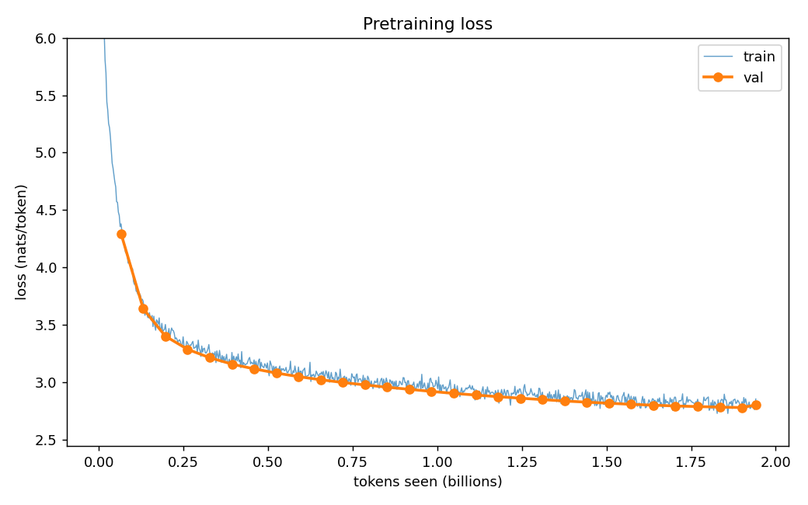
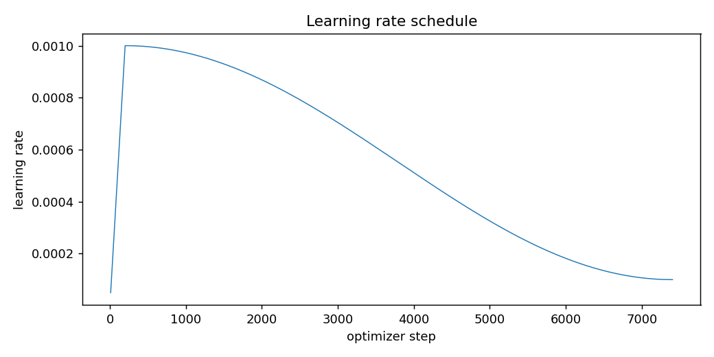
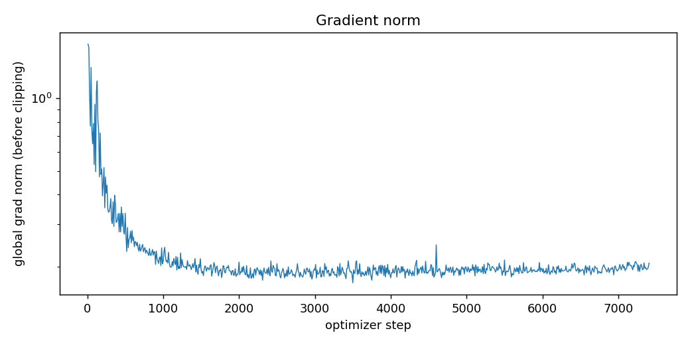

# Stage 5 — Full pretraining (D6), Kaggle T4×2

**Status:** done. All 7,405 steps (1.941B tokens, ≈ 1 epoch of `tokenized/v2/hi_unigram_10240` train) ran over 2 sessions with no halt conditions hit.
- **Kernel:** `prateek99491/hindi-lm-d6-pretrain` (`python -m train.d6_pipeline`, Stage 5 part = `train.stage5`).
- **Config:** [configs/pretrain_61m.yaml](../../configs/pretrain_61m.yaml): peak LR 1e-3 (Stage 4), micro-batch 8 × grad_accum 16 × 2 GPUs = 262,144 tokens/step, `torch.compile`, fp16 + GradScaler.
- **Outputs on HF** `Prateek-Tiwari10/hindi-lm-checkpoints`: `pretrain_61m/step_007405/ckpt.pt` (final, `latest.txt`), `step_007000/`, `best/model.pt` (step 7,250), `logs/pretrain_61m.jsonl`, and `d6_results/` (log copy, session summary, plots).
- **Local copies:** [pretrain_61m.jsonl](pretrain_61m.jsonl), [stage5_session.json](stage5_session.json) (session 2 summary), [best_info.json](best_info.json), plots in [plots/](plots/).

Periodic evals use the fixed 512-window val subset. The final step evaluates all 4,468 val windows, so its number is **not** comparable to the subset numbers.

## Session 1 — 2026-10-21

| item | value |
| --- | --- |
| steps | 0 → 6,800 (saved checkpoint: 6,500; resumed from there) |
| tokens seen at step 6,500 | 1.704B |
| last train loss (step 6,500) | 2.872 |
| last val loss / BPB / PPL (subset, step 6,500) | 2.7963 / 0.4313 / 16.38 |
| tokens/s (median) | 57,650 (MFU 20.5%) |
| max grad norm after step 100 | 1.18 |
| GradScaler min scale | 65,536 (never below 1) |
| peak GPU memory | 4.02 GB |

**Anomaly:** the session stopped at step ~6,800 with HF error "private storage limit exceeded". It was not a training failure. Pruned checkpoints kept using quota through git history (the repo showed 4.75 GB but used 20.7 GB). Fix (2026-10-22): deleted `sweep/` (its logs are kept in `d6_results/`), squashed history and removed the unreferenced blobs, bringing the repo to 1.74 GB. The checkpoint manager now also frees storage on prune. Steps 6,501–6,800 were lost and redone in session 2.

## Session 2 — 2026-10-22/23

| item | value |
| --- | --- |
| steps | 6,500 → 7,405 (resumed from `step_006500`) |
| wall time | 4,720 s (≈ 1 h 19 min) |
| tokens seen (end) | 1,941,176,320 |
| last train loss | 2.857 |
| val loss (subset), step 7,250 (**best**) | 2.7825 / BPB 0.4292 / PPL 16.16 |
| val loss (all 4,468 windows), step 7,405 | 2.8050 / BPB 0.4353 / PPL 16.53 |
| tokens/s (median) | 52,764 (MFU 18.7%) |
| max grad norm | 0.21 |
| GradScaler min scale | 524,288 |
| halts | none |

## Whole run

Val loss on the 512-window subset:

| step | tokens | val loss | val BPB |
| --- | --- | --- | --- |
| 250 | 0.066B | 4.296 | 0.6626 |
| 750 | 0.197B | 3.404 | 0.5250 |
| 1,750 | 0.459B | 3.119 | 0.4811 |
| 2,750 | 0.721B | 3.001 | 0.4629 |
| 3,750 | 0.983B | 2.923 | 0.4508 |
| 4,750 | 1.245B | 2.864 | 0.4418 |
| 5,750 | 1.507B | 2.820 | 0.4350 |
| 6,750 | 1.769B | 2.791 | 0.4305 |
| 7,250 | 1.901B | **2.783** | **0.4292** |

- **Stop conditions:** no NaN loss. GradScaler scale never fell below 65,536. Val loss never rose between consecutive subset evals (longest run of rises: 0).
- **Stability:** grad norm stayed ≤ 1.7 throughout (≤ 0.5 after warmup) and no loss spikes occurred.
- **Diminishing returns:** over the last ~0.4B tokens val loss improved by only ~0.02. More data, or a second epoch, would help less than a bigger model.

## Next

Stage 6: kernel `hindi-lm-d6-eval` on `best/`. It measures full val and test loss, PPL and BPB, generates samples for 10 fixed prompts × 3 decoding settings, and computes repetition and Distinct-1/2.
