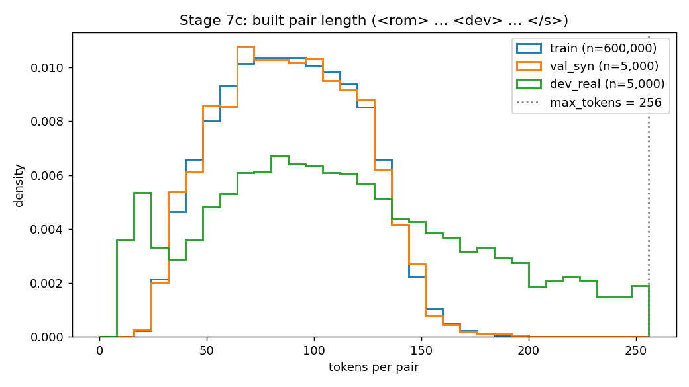

# Stage 7c — Hinglish → Devanagari pair dataset (D10), Kaggle CPU

**Status:** done 2026-11-17. **Gate 7c: PASS** with `romanize-v2`. Stage 7e trained on **`romanize-v2.1`** (2026-11-22), which differs from v2 only by seven shortcut entries; see [romanize-v2.1](#romanize-v21-used-for-stage-7e).

**Version history:**
- `romanize-v1` (revision `cee750e`) passed the numeric gate but failed the 30-sample read: about 15 of ~400 words were wrong, most of them common words.
- Prateek's review led to `romanize-v2`. That review set the source precedence, count² weighting, an inflection guard on Aksharantar only, the clean/contaminated split, and a decode cap derived from the data.

**Runs:**
- **Full build:** `prateek99491/hindi-lm-d7c-data`, version 6, started with Save Version (HF_TOKEN secret), command `python -m data.hinglish.stage7c all`.
  - Ran 2026-11-17 06:16:46 → 2026-11-17 06:37:10 UTC; config hash `26ab6dc68db4`.
  - The runner's test suite passed first: 186 passed, 1 skipped.
  - Version 4 had already run the public-data `realism` mode with the same code; version 3 crashed on a variable-name bug that was then fixed.
- **Upload:** private `Prateek-Tiwari10/hindi-lm-hinglish-pairs` at `romanize-v2/`, revision **`f9e10dfb68bd824a89e0d256de7641826ee2ca88`** (190 MB).
  - `romanize-v1/` is still in the repo; delete it once 7e is pinned to v2.
- **Outputs:** [stage7c.json](stage7c.json) and [stage7c_lengths.png](stage7c_lengths.png).
- **Code:**
  - [data/hinglish/romanize.py](../../data/hinglish/romanize.py), [data/hinglish/sentences.py](../../data/hinglish/sentences.py), [data/hinglish/stage7c.py](../../data/hinglish/stage7c.py)
  - [configs/hinglish_data.yaml](../../configs/hinglish_data.yaml)
  - tests: [tests/test_romanize.py](../../tests/test_romanize.py), [tests/test_hinglish_lexicon.py](../../tests/test_hinglish_lexicon.py)

## Gate

| check | target | v1 | **v2** |
| --- | --- | --- | --- |
| lexicon coverage (shortcut + lexicon share of word tokens, train) | ≥ 0.80 | 0.8724 | **0.8628** ✅ |
| leakage in train / val_syn (exact + MinHash ≥ 0.8 vs dev, test and chat) | 0 | 0 / 0 | **0 / 0** ✅ |
| train ∩ val_syn | 0 | 0 | **0** ✅ |
| realism: word agreement with Dakshina dev humans | ≥ 0.30 | 0.5656 | **0.6269** ✅ |
| 30 random train pairs: clearly wrong words (wrong word or inflection) | ≤ 4 of ~400 (Prateek) | ~9 (+6 implausible spellings) | **1** ✅ |

## Sources

| source | use | license | integrity |
| --- | --- | --- | --- |
| Dakshina v1.0 (`https://storage.googleapis.com/gresearch/dakshina/dakshina_dataset_v1.0.tar`) | train lexicon (`hi.translit.sampled.train.tsv`); dev/test rejoined romanized sentences → `dev_real` / `test_real` | CC BY-SA 4.0 | archive 2,008,340,480 B, sha256 `83530bec211893d9df429298f42e63c350c25ad56f9f5172f85edb0575ee5b03` |
| Aksharantar `ai4bharat/Aksharantar` `hin.zip` | train word pairs (1,299,155 rows) for words Dakshina lacks | CC-BY (manually collected part), CC0 (mined part); see the dataset card | sha256 `208c2d1b128234e6dc777b750779b4f5e6214ab43244039349b530bf9868bdaf` |
| v2 pretraining train shards (`hindi-lm-data/final_v2/train/`, 113 shards) | source sentences; contamination scan | — | — |
| `data/hinglish/chat_test.tsv` (Prateek, private, gitignored) | `test_chat` (180 pairs) | — | not committed |

Aksharantar rows by origin: IndicCorp 956,190, Samanantar 152,778, Existing 131,773, Dakshina 24,727, Wikidata 24,528, AK-Freq 9,159.

## Lexicon (romanize-v2)

**Rules:**
1. A word in the Dakshina train lexicon uses **only** its Dakshina spellings.
2. Aksharantar fills in only words Dakshina lacks. Each spelling must pass four checks against `rule_romanize(word)`:
   - edit distance / longer length ≤ 0.34;
   - the same **first sound** (c/k/q, w/v, z/j, ph/f, sh/s folded; aspiration kept);
   - the same **final vowel class** (A / E / I / O / U / consonant, with nasal endings handled);
   - the **inflection guard**: not the rule spelling or a Dakshina spelling of a *different* word. This removes `sakta` for सकते.
3. The guard never removes Dakshina spellings, so shared spellings such as `ki` for कि/की stay.
4. Spellings are sampled with p ∝ count^2. Count-1 spellings are dropped when the top count is ≥ 5.
5. All variety beyond that comes from the noise module.

| | v1 | v2 |
| --- | --- | --- |
| word types | 1,098,338 | 926,747 (24,990 Dakshina + 901,757 Aksharantar) |
| spellings (avg per word) | 1,244,155 (1.133) | 1,000,782 (1.08) |
| Aksharantar rows kept | 1,223,632 | 957,061 |
| sampling weight | count | count² |
| count-1 spellings dropped | — | 460 |
| Aksharantar words with every spelling rejected (→ rules) | — | 233,750 |

Rejected rows (v2): `aksharantar:charset` 1, `aksharantar:final_vowel` 28,359, `aksharantar:first_sound` 4,842, `aksharantar:inflection_guard` 53,077, `aksharantar:length` 1,344, `aksharantar:rule_distance` 201,790, `aksharantar:word_in_dakshina` 52,681, `dakshina:length` 16.

## Realism (Dakshina dev, 5,000 sentences; aligned sentences only)

| romanizer | word agreement | char-bigram KL (human ‖ this) | agreement: shortcut / lexicon / rules | word source share: shortcut / lexicon / rules |
| --- | --- | --- | --- | --- |
| v1 generator | 0.5656 | 0.0164 | 0.517 / 0.580 / 0.515 | 0.1431 / 0.7225 / 0.1344 |
| **v2 generator** | 0.6269 | 0.0122 | 0.519 / 0.671 / 0.500 | 0.1431 / 0.7113 / 0.1456 |
| v2 generator, clean level only | 0.6333 | 0.0129 | 0.521 / 0.681 / 0.494 | 0.1431 / 0.7113 / 0.1456 |
| rule-only baseline | 0.6201 | 0.0684 | — / — / 0.618 | 0.0 / 0.0 / 1.0 |

- **v2 now beats rule-only on exact agreement** and stays about 5× closer to human text on character statistics, which is what the noise and variants are for.
- **Aligned sentences:** 4838/5000.
- **Dandas:** humans end 99.0% of danda-final sentences (3,860 of them) with '.'. Hence `danda_to_dot_p` = 0.9.
- **Caveat:** the shortcut table was partly informed by Dakshina dev word frequencies (`men` for में), so dev agreement slightly favours the generator. `test_real` and `test_chat` were never used this way.

## Source sentences (v2 train scan)

| source | shards | docs | sentences | candidates (4–20 words, ≥ 95% Devanagari) | conversational |
| --- | --- | --- | --- | --- | --- |
| manual | 11 | 224,222 | 4,613,774 | 2,158,722 | 232,173 |
| sangraha_verified | 100 | 2,849,013 | 62,276,728 | 37,036,825 | 5,882,353 |
| wikipedia | 2 | 69,511 | 2,252,465 | 1,144,464 | 55,534 |

- **Per-shard sampling:** 6,000 conversational + 3,000 general per shard → 678,000 + 339,000.
- **After exact dedup:** 667,371 + 334,033.
- **Leakage removal** against Dakshina dev/test and the chat set: 135 exact + 2 near-duplicates, leaving 667,303 + 333,964.
- **Conversational** means a sentence containing one of 20 chat words (मैं, क्या, नहीं …).

## Contamination of the real eval sets (seen in v2 pretraining)

| split | sentences | exact | near only | contaminated | **clean** | contaminated share |
| --- | --- | --- | --- | --- | --- | --- |
| dev_real | 5,000 | 3,674 | 67 | 3,741 | **1,259** | 74.8% |
| test_real | 5,000 | 3,661 | 92 | 3,753 | **1,247** | 75.1% |
| test_chat | 180 | 17 | 0 | 17 | **163** | 9.4% |

- **Definition:** contaminated = exact match (sentence key over *every* v2 train sentence) or MinHash near-duplicate (word 3-grams, agreement ≥ 0.8). The near-duplicate scan covers only the `wikipedia` and `manual` shards. Clean is therefore clean as far as this check can tell.
- **Why so high:** Dakshina sentences are Wikipedia sentences, and the pretraining corpus contains Wikipedia. The model has seen the Devanagari side of about 75% of `dev_real` and `test_real` (not the romanized side).
- **Reporting:** every record carries `contamination: exact | near | clean`. All `dev_real` / `test_real` results are reported on the clean and contaminated parts separately, ablation A1 included.
- **Model selection:** because dev is 74.8% contaminated, selection uses the **clean** dev CER (`eval.clean_selection_above` = 0.25; see `stage7d_RESULTS.md`).
- **`test_chat`:** 17 of its 180 short everyday sentences also occur verbatim in pretraining. They are common phrases, not leaks; the file itself is never uploaded or committed. They are tagged the same way.

## Splits

| split | pairs | tokens | mean / p50 / p99 / max tokens | > 256 | `<lunk>` pairs | conversational | noise clean / mild / heavy |
| --- | --- | --- | --- | --- | --- | --- | --- |
| val_syn | 5,000 | 441,008 | 88.2 / 88 / 155 / 193 | 0 | 0 | 0.7 | 1,749 / 2,266 / 985 |
| train | 600,000 | 53,094,714 | 88.5 / 88 / 156 / 256 | 0 | 0 | 0.7 | 210,233 / 269,725 / 120,042 |
| dev_real | 5,000 | 664,411 | 132.9 / 114 / 454 / 2277 | 425 | 77 | 0.085 | — (human) |
| test_real | 5,000 | 654,153 | 130.8 / 111 / 446 / 1236 | 445 | 73 | 0.0766 | — (human) |
| test_chat | 180 | 5,791 | 32.2 / 32 / 52 / 55 | 0 | 0 | 0.5111 | — (human) |

- **Train/val_syn:** pairs over 256 tokens are dropped and replaced (train: 39).
- **Real splits** are kept whole. Training-time dev evaluation uses pairs ≤ 256 tokens; the final evaluation decides how to treat longer ones.
- **Overlap:** `dev_real` and `test_real` share 40 sentences, inside Dakshina itself.
- **Noise mix:** 35 / 45 / 20 as specified.
- **Word sources in train:** shortcut 0.2116, lexicon 0.65, rules 0.1384.
- **Format:** `<split>.jsonl.gz` plus `uint16` `ids` / `offsets` / `prompt_len` arrays built with `hinglish-v1` (vocab 10,304).

## Decode cap (for Stage 7d/7e greedy decoding)

- **Formula:** `max_new = ceil(0.56 × 1.5 × rom_chars) + 8`, capped at 256.
  - 0.56 is the 99.9th percentile over `train` of Devanagari tokens (including eos) per romanized character.
  - It is stored in `meta.json` and read by `finetune/sft.py`.
- **References longer than their cap:** val_syn 0, train 8, dev_real 2, test_real 1, test_chat 0. The cap almost never cuts a correct output.
- **Effect on cost:** the step-0 run-on from G6 now stops near the reference length instead of at 256 tokens.

## 30 random train pairs (v2) — eyeball check

| # | noise | romanized | Devanagari |
| --- | --- | --- | --- |
| 0 | mild | uska apna swatantra astitva tha aur hai bhi . | उसका अपना स्वतंत्र अस्तित्व था और है भी । |
| 1 | clean | par aaj khushi is baat ki bhi hai ki aap sab mujh par bharosa karte h. | पर आज खुशी इस बात की भी है कि आप सब मुझ पर भरोसा करते हैं। |
| 2 | mild | abhibhavakon ke mann se yeh baat mitani hai k sarkari schoolon mein padhai nai hoti. | अभिभावकों के मन से यह बात मिटानी है कि सरकारी स्कूलों में पढ़ाई नहीं होती। |
| 3 | mild | apne bistar par murde ki tarah leta woh ajeeb-se in haaw-bhavon ko pataa nhi kab tak dekhta rhata h . | अपने बिस्तर पर मुर्दे की तरह लेटा वह अजीब-से इन हाव-भावों को पता नहीं कब तक देखता रहता है । |
| 4 | clean | bhala yeh bhi koi baat hui. | भला ये भी कोई बात हुई। |
| 5 | heavy | jammu-kashmeer main parisamin kyu? | जम्मू-कश्मीर में परिसमीन क्यों? |
| 6 | heavy | shanivaar ko chhatra ne ma ke sath nagar thane pahunchkar aapbeeti sunayi. | शनिवार को छात्रा ने मां के साथ नगर थाने पहुंचकर आपबीती सुनाई। |
| 7 | clean | lekin yeh tasvir sirf filmi nhi hai. sach hai. aur jharkhand me jagah-jagah dikhti he. khaaskar wahaa jahan koyla h. | लेकिन ये तस्वीर सिर्फ़ फ़िल्मी नहीं है. सच है. और झारखंड में जगह-जगह दिखती है. ख़ासकर वहाँ जहाँ कोयला है. |
| 8 | mild | parantu samitiyon dwara vaanchit abhilekh uplabdh nai karaaye gaye. | परन्तु समितियों द्वारा वांछित अभिलेख उपलब्ध नहीं कराये गये। |
| 9 | clean | bata den, panchayat chunav ke liye bangal men 8 july ko matdan hua tha. | बता दें, पंचायत चुनाव के लिए बंगाल में 8 जुलाई को मतदान हुआ था। |
| 10 | heavy | bhajpa kaaryakartaaon ko saunpi jimmedaariyan | भाजपा कार्यकर्ताओं को सौंपी जिम्मेदारियां |
| 11 | mild | tardi veg kile se utarkar niche aaya aur un logon se bhent ki. | तरदी वेग किले से उतरकर नीचे आया और उन लोगों से भेंट की। |
| 12 | mild | prerna kahati hai ki main tumhaare bacche ki maa banne wali hun. | प्रेरणा कहती है कि मैं तुम्हारे बच्चे की मां बनने वाली हूं। |
| 13 | mild | ye file ek trojan hoti hai, jo installation ke baad system ki windows registry men data store karti hai | यह फाइल एक ट्रोजन होती है, जो इंस्टॉलेशन के बाद सिस्टम की विंडोज रजिस्ट्री में डाटा स्टोर करती है। |
| 14 | clean | aise savaalon par kareena jhalla padi theen aur unhone gusse mein kaha tha ki, "main pregnant hun, mari nai hun. | ऐसे सवालों पर करीना झल्ला पड़ी थीं और उन्होंने गुस्से में कहा था कि, "मैं प्रेगनेंट हूं, मरी नहीं हूं। |
| 15 | heavy | "bihari bol utha- "aap phikra naa karen girana ya behosh ho jaane ki bhumika nhi. | "बिहारी बोल उठा- "आप फिक्र न करें गिरना या बेहोश हो जाने की भूमिका नहीं। |
| 16 | heavy | palwal, 18 february (hapra) | पलवल, 18 फरवरी (हप्र) |
| 17 | clean | 'pinglaa' bhi meri maigadleen ki tarah ek aisi ganika ki kahani thi, jisey mukti mili . | 'पिंगला' भी मेरी मैगडलीन की तरह एक ऐसी गणिका की कहानी थी, जिसे मुक्ति मिली । |
| 18 | mild | trektar loan kahan milata he? | ट्रेक्टर लोन कहाँ मिलता है? |
| 19 | mild | investors ko inwest karke 70 himachaliyon ko rojgar dena he | इनवेस्टर्स को इनवेस्ट करके 70% हिमाचलियों को रोजगार देना है। |
| 20 | clean | roos ka kahana hai ki japan ke uttar me vivadit deep kuril par abhyas nhi kiya jaega. | रूस का कहना है कि जापान के उत्तर में विवादित दीप कुरिल पर अभ्यास नहीं किया जाएगा. |
| 21 | mild | aam janata ki suraksha ki guarantee kese ho. | आम जनता की सुरक्षा की गारंटी कैसे हो। |
| 22 | clean | she jinping: china ka sabse taaqatvar neta jisey takkar dene vala koi nai | शी जिनपिंग: चीन का सबसे ताक़तवर नेता जिसे टक्कर देने वाला कोई नहीं |
| 23 | mild | is sutra ka ye arth nhi h ki jo mila hai, usko maango. | इस सूत्र का यह अर्थ नहीं है कि जो मिला है, उसको मांगो। |
| 24 | mild | koi hindu pratimaako hi svay ishwar nhi maanata. | कोई हिन्दू प्रतिमाको ही स्वय ईश्वर नहीं मानता। |
| 25 | clean | marij aur doktars donon sajag rahen to preemechyor delivery ko tala jaa sakta hai. | मरीज और डॉक्टर्स दोनों सजग रहें तो प्रीमेच्योर डिलीवरी को टाला जा सकता है। |
| 26 | heavy | haikort ki gvalior khandpith ne bsc narsing ki parikshaon par lagai gayi rok ko hatane se inkar kar diya hai | हाईकोर्ट की ग्वालियर खंडपीठ ने बीएससी नर्सिंग की परीक्षाओं पर लगाई गई रोक को हटाने से इनकार कर दिया है। |
| 27 | mild | aap hafte men ek bar methi ke pani se balon ko dho bhi sakte hain. | आप हफ्ते में एक बार मेथी के पानी से बालों को धो भी सकते हैं। |
| 28 | clean | guruwar ko tahsil prashaasan ko shikayat mili k naali ko band kar diya gaya hai. | गुरुवार को तहसील प्रशासन को शिकायत मिली कि नाली को बंद कर दिया गया है। |
| 29 | heavy | "or jo vahaan rahenge, kya unka rishta taajamhal shreer jama masjid se tut jayega ? | "और जो वहाँ रहेंगे, क्या उनका रिश्ता ताजमहल श्रीर जामा मस्जिद से टूट जायेगा ? |

**Reading (about 400 words):**
- **Clearly wrong:** **1**, `girana` for गिरना in #15 (`girana` is गिराना).
- **Odd but human-like variants:** `rhata` (#3), `phikra` (#15), `k` for कि, `main` for में.
- **Not a spelling error:** in #19, "70%" became "70". `%` is not in the 7a Latin table, so the romanizer drops it while the target keeps it.
- **v1, for comparison:** about 9 wrong words (`sakta`×2, `khoyi`, `arrange`, `sahaare`, `dodoan`×2, `yards`, `hoten`) and 6 implausible spellings.

## Spelling distribution, 200 most frequent words in train

Columns:
- **Spelling:** the share of each spelling before noise.
- **After noise:** what the model actually sees.
- **Source:** **s**hortcut / **l**exicon / **r**ules.
- **Human:** Dakshina dev annotators, where the word occurs there.

| word | count | spelling | after noise | src | rule | human (Dakshina dev) |
| --- | --- | --- | --- | --- | --- | --- |
| है | 260,662 | hai 0.60 h 0.20 he 0.20 | hai 0.60 h 0.20 he 0.20 | s1.00 | hai | hai 0.98 hain 0.01 hi 0.00 |
| नहीं | 227,693 | nahi 0.50 nhi 0.30 nahin 0.10 nai 0.10 | nahi 0.47 nhi 0.33 nahin 0.10 nai 0.10 | s1.00 | naheen | nahi 0.62 nahin 0.35 nahim 0.01 |
| के | 207,155 | ke 0.61 k 0.39 | ke 0.61 k 0.39 | l1.00 | ke | ke 0.99 ka 0.00 k 0.00 |
| में | 179,819 | men 0.36 me 0.28 mein 0.27 main 0.09 | men 0.36 me 0.28 mein 0.27 main 0.09 | s1.00 | men | men 0.43 me 0.28 mein 0.26 |
| की | 141,059 | ki 1.00 | ki 1.00 | l1.00 | ki | ki 0.94 kii 0.04 kee 0.01 |
| से | 117,094 | se 0.90 say 0.10 | se 0.90 say 0.10 | l1.00 | se | se 0.99 men 0.00 sse 0.00 |
| को | 109,022 | ko 0.90 co 0.10 | ko 0.90 co 0.10 | l1.00 | ko | ko 0.99 ki 0.00 ke 0.00 |
| हैं | 107,169 | hain 0.56 hai 0.33 h 0.11 | hain 0.56 hai 0.33 h 0.11 | s1.00 | hain | hain 0.66 hai 0.32 haim 0.01 |
| का | 99,536 | ka 1.00 | ka 1.00 | l1.00 | ka | ka 0.98 kaa 0.01 k 0.00 |
| और | 93,329 | aur 0.70 or 0.30 | aur 0.70 or 0.30 | s1.00 | aur | aur 0.97 aura 0.02 and 0.00 |
| भी | 84,039 | bhi 1.00 | bhi 1.00 | s1.00 | bhi | bhi 0.99 bhii 0.00 hi 0.00 |
| कि | 79,663 | ki 0.88 k 0.12 | ki 0.88 k 0.12 | s1.00 | ki | ki 0.99 pratyaropit 0.00 kri 0.00 |
| पर | 69,027 | par 1.00 | par 1.00 | l1.00 | par | par 0.94 para 0.03 pr 0.02 |
| ने | 61,585 | ne 1.00 | ne 1.00 | l1.00 | ne | ne 0.99 ke 0.00 se 0.00 |
| तो | 52,867 | to 0.75 toh 0.25 | to 0.75 toh 0.25 | s1.00 | to | to 0.99 yah 0.01 |
| क्या | 50,778 | kya 0.89 kia 0.11 | kya 0.89 kia 0.11 | s1.00 | kya | kya 0.96 kyaa 0.04 |
| इस | 48,299 | is 1.00 | is 1.00 | l1.00 | is | is 0.97 isa 0.02 us 0.00 |
| हो | 47,978 | ho 1.00 | ho 1.00 | l1.00 | ho | ho 0.99 jo 0.00 hi 0.00 |
| यह | 47,420 | yeh 0.50 ye 0.40 yah 0.10 | yeh 0.50 ye 0.40 yah 0.10 | s1.00 | yah | yah 0.86 yeh 0.10 yaha 0.01 |
| ही | 47,026 | hi 1.00 | hi 1.00 | r1.00 | hi | hi 0.94 hii 0.05 hee 0.01 |
| आप | 45,909 | aap 0.70 ap 0.30 | aap 0.61 ap 0.39 | s1.00 | aap | aap 0.96 ap 0.04 |
| एक | 45,040 | ek 1.00 | ek 1.00 | l1.00 | ek | ek 0.97 eka 0.02 eak 0.00 |
| कर | 42,625 | kar 0.80 kr 0.20 | kar 0.80 kr 0.20 | s1.00 | kar | kar 0.98 kara 0.02 karli 0.00 |
| लिए | 40,701 | liye 1.00 | liye 1.00 | l1.00 | liye | liye 0.76 lie 0.23 le 0.00 |
| कोई | 38,318 | koi 1.00 | koi 1.00 | l1.00 | koi | koi 0.99 koyi 0.01 |
| था | 37,529 | tha 1.00 | tha 1.00 | l1.00 | tha | tha 0.96 thaa 0.03 hai 0.00 |
| मैं | 36,128 | main 0.50 mai 0.30 me 0.20 | main 0.50 mai 0.30 me 0.20 | s1.00 | main | main 0.63 mai 0.16 men 0.10 |
| हम | 34,716 | hum 0.80 ham 0.20 | hum 0.80 ham 0.20 | s1.00 | ham | ham 0.88 hum 0.12 |
| किया | 29,410 | kiya 1.00 | kiya 1.00 | r1.00 | kiya | kiya 0.97 kiyaa 0.02 kiye 0.00 |
| कहा | 27,441 | kaha 1.00 | kaha 0.94 kha 0.06 | l1.00 | kaha | kaha 0.96 kah 0.02 kahaa 0.01 |
| वह | 25,746 | woh 0.42 vo 0.25 wo 0.25 vah 0.08 | woh 0.37 vo 0.25 wo 0.25 vah 0.07 | s1.00 | vah | vah 0.60 wah 0.22 veh 0.14 |
| गया | 25,575 | gaya 0.70 gya 0.30 | gaya 0.65 gya 0.35 | s1.00 | gaya | gaya 0.99 jata 0.00 ki 0.00 |
| लेकिन | 23,623 | lekin 1.00 | lekin 1.00 | l1.00 | lekin | lekin 0.96 lekina 0.02 leking 0.01 |
| तक | 22,480 | tak 1.00 | tak 1.00 | l1.00 | tak | tak 0.97 taka 0.02 tka 0.01 |
| साथ | 22,270 | saath 0.64 sath 0.36 | saath 0.56 sath 0.44 | l1.00 | saath | sath 0.61 saath 0.36 satha 0.02 |
| करने | 22,017 | karane 1.00 | karane 0.94 krane 0.06 | l1.00 | karne | karne 0.94 karane 0.06 kanre 0.00 |
| अपने | 21,726 | apne 1.00 | apne 1.00 | l1.00 | apne | apne 0.97 apane 0.03 apni 0.01 |
| कुछ | 21,589 | kuchh 0.80 kuch 0.20 | kuchh 0.80 kuch 0.20 | l1.00 | kuchh | kuch 0.53 kuchh 0.43 kucha 0.03 |
| किसी | 20,437 | kisi 1.00 | kisi 1.00 | l1.00 | kisi | kisi 0.97 kis 0.02 kji 0.01 |
| रहे | 19,808 | rahe 0.60 rhe 0.40 | rahe 0.56 rhe 0.44 | s1.00 | rahe | rahe 0.97 rhe 0.03 |
| सकते | 19,710 | sakte 0.80 sakate 0.20 | sakte 0.75 sakate 0.19 skte 0.05 skate 0.01 | l1.00 | sakte | sakte 0.98 sakta 0.02 |
| मुझे | 19,568 | mujhe 0.80 mjhe 0.20 | mujhe 0.80 mjhe 0.20 | s1.00 | mujhe | mujhe 1.00 |
| रहा | 19,447 | raha 0.60 rha 0.40 | raha 0.57 rha 0.43 | s1.00 | raha | raha 0.94 rha 0.06 |
| थी | 18,472 | thi 1.00 | thi 1.00 | l1.00 | thi | thi 0.94 thee 0.04 hai 0.01 |
| जो | 17,513 | jo 1.00 | jo 1.00 | r1.00 | jo | jo 0.98 ji 0.01 ko 0.01 |
| थे | 17,443 | the 1.00 | the 1.00 | l1.00 | the | the 0.99 he 0.00 tha 0.00 |
| बाद | 16,909 | bad 0.50 baad 0.50 | bad 0.57 baad 0.43 | l1.00 | baad | baad 0.89 bad 0.09 baat 0.01 |
| अब | 16,809 | ab 0.79 aab 0.21 | ab 0.82 aab 0.18 | l1.00 | ab | ab 0.97 aba 0.03 |
| सकता | 16,104 | sakta 0.80 sakata 0.20 | sakta 0.75 sakata 0.19 skta 0.05 skata 0.01 | l1.00 | sakta | sakta 0.91 saktaa 0.04 sakataa 0.02 |
| उन्होंने | 15,626 | unhone 1.00 | unhone 1.00 | l1.00 | unhonne | unhone 0.79 unhonne 0.17 unhonen 0.03 |
| जा | 15,533 | ja 0.69 jaa 0.31 | ja 0.73 jaa 0.27 | l1.00 | ja | ja 0.75 jaa 0.25 |
| दिया | 15,257 | diya 1.00 | diya 1.00 | l1.00 | diya | diya 0.99 diyaa 0.01 |
| बात | 14,933 | baat 1.00 | baat 0.87 bat 0.13 | l1.00 | baat | baat 0.84 bat 0.11 bata 0.02 |
| या | 14,493 | ya 1.00 | ya 1.00 | l1.00 | ya | ya 0.93 yaa 0.05 narak 0.01 |
| होता | 14,435 | hota 1.00 | hota 1.00 | r1.00 | hota | hota 0.98 hot 0.01 hotaa 0.00 |
| रही | 14,247 | rahi 0.60 rhi 0.40 | rahi 0.56 rhi 0.44 | s1.00 | rahi | rahi 0.97 rahin 0.03 |
| हुआ | 14,166 | hua 1.00 | hua 1.00 | l1.00 | hua | hua 0.94 huaa 0.05 hya 0.01 |
| ये | 14,111 | ye 0.66 yeh 0.34 | ye 0.66 yeh 0.34 | s1.00 | ye | ye 0.98 uye 0.01 haiye 0.01 |
| न | 14,013 | naa 1.00 | naa 0.87 na 0.13 | l1.00 | na | na 0.57 n 0.43 |
| करते | 13,855 | karte 0.87 karate 0.13 | karte 0.81 karate 0.13 krte 0.05 krate 0.01 | l1.00 | karte | karte 0.96 karate 0.02 prayog 0.01 |
| इसके | 13,772 | iske 0.80 isake 0.20 | iske 0.80 isake 0.20 | l1.00 | iske | iske 0.94 isake 0.04 sike 0.01 |
| क्यों | 13,660 | kyu 0.39 kyon 0.30 kyun 0.30 | kyu 0.39 kyon 0.30 kyun 0.30 | s1.00 | kyon | kyon 0.67 kyo 0.33 |
| कैसे | 13,591 | kaise 0.81 kese 0.19 | kaise 0.81 kese 0.19 | s1.00 | kaise | kaise 1.00 |
| गई | 12,709 | gayi 0.45 gai 0.37 gyi 0.19 | gayi 0.42 gai 0.37 gyi 0.21 | s1.00 | gai | gai 0.82 gayi 0.16 gaii 0.02 |
| समय | 12,379 | samay 0.90 samaya 0.10 | samay 0.90 samaya 0.09 smaya 0.01 | l1.00 | samay | samay 0.96 samaya 0.02 samyy 0.01 |
| होने | 12,089 | hone 1.00 | hone 1.00 | l1.00 | hone | hone 1.00 |
| वे | 11,829 | way 0.89 ve 0.11 | way 0.78 vay 0.12 ve 0.09 we 0.01 | l1.00 | ve | ve 0.82 we 0.16 vve 0.01 |
| हुए | 11,808 | hue 0.91 huye 0.09 | hue 0.91 huye 0.09 | l1.00 | huye | huye 0.57 hue 0.40 hye 0.02 |
| करना | 11,666 | karna 1.00 | karna 0.94 krna 0.06 | r1.00 | karna | karna 0.97 karana 0.01 karnaa 0.01 |
| होगा | 11,601 | hoga 1.00 | hoga 1.00 | l1.00 | hoga | hoga 0.96 hogaa 0.04 |
| तरह | 11,406 | tarah 1.00 | tarah 1.00 | l1.00 | tarah | tarah 0.97 trarah 0.01 tarag 0.01 |
| तुम | 11,044 | tum 1.00 | tum 1.00 | l1.00 | tum | tum 1.00 |
| बहुत | 10,859 | bahut 0.54 bohot 0.28 bhut 0.18 | bahut 0.54 bohot 0.28 bhut 0.18 | s1.00 | bahut | bahut 0.93 bahuta 0.06 bahu 0.01 |
| पहले | 10,821 | pahle 0.65 pehle 0.28 pahale 0.07 | pahle 0.65 pehle 0.28 pahale 0.07 | l1.00 | pahle | pahle 0.45 pahale 0.30 pehle 0.22 |
| हूं | 10,726 | hun 0.38 hu 0.37 hoon 0.25 | hun 0.41 hu 0.37 hoon 0.22 | s1.00 | hoon | hun 0.80 hu 0.20 |
| अपनी | 10,663 | apni 1.00 | apni 1.00 | l1.00 | apni | apni 0.93 apne 0.04 apani 0.02 |
| चाहिए | 10,643 | chahie 0.34 chahiye 0.33 chaahie 0.33 | chahie 0.38 chahiye 0.31 chaahie 0.29 chhiye 0.02 | l1.00 | chaahiye | chahiye 0.83 chaahiye 0.13 chahie 0.03 |
| लोगों | 10,642 | logon 1.00 | logon 1.00 | r1.00 | logon | logon 0.66 logo 0.32 lgon 0.01 |
| फिर | 10,628 | fir 1.00 | fir 1.00 | l1.00 | phir | fir 0.66 phir 0.32 fhir 0.01 |
| काम | 10,621 | kaam 0.61 kam 0.39 | kaam 0.54 kam 0.46 | l1.00 | kaam | kaam 0.85 kam 0.14 |
| जब | 10,610 | jab 0.90 jb 0.10 | jab 0.90 jb 0.10 | l1.00 | jab | jab 0.94 jaba 0.02 yah 0.01 |
| ऐसा | 10,450 | aisa 1.00 | aisa 1.00 | l1.00 | aisa | aisa 0.97 yesa 0.03 |
| ठीक | 10,350 | thik 0.50 theek 0.50 | thik 0.57 theek 0.43 | s1.00 | theek | thik 0.80 theek 0.13 thil 0.07 |
| उन्हें | 10,146 | unhen 0.81 unhein 0.19 | unhen 0.81 unhein 0.19 | l1.00 | unhen | unhe 0.49 unhen 0.41 unhein 0.04 |
| कभी | 10,123 | kabhi 1.00 | kabhi 0.94 kbhi 0.06 | l1.00 | kabhi | kabhi 0.97 kahi 0.03 |
| जाता | 9,961 | jata 0.66 jaata 0.17 jaataa 0.17 | jata 0.66 jaataa 0.15 jaata 0.15 jta 0.05 | l1.00 | jaata | jata 0.92 jaata 0.07 jataa 0.00 |
| लोग | 9,909 | log 1.00 | log 1.00 | r1.00 | log | log 0.95 loga 0.03 lof 0.01 |
| उनके | 9,836 | unke 1.00 | unke 1.00 | l1.00 | unke | unke 0.96 unake 0.02 junke 0.01 |
| हुई | 9,770 | hui 1.00 | hui 1.00 | l1.00 | hui | hui 0.97 huyi 0.02 hue 0.01 |
| मेरी | 9,271 | meri 1.00 | meri 1.00 | l1.00 | meri | meri 0.89 mary 0.11 |
| उसे | 9,266 | use 1.00 | use 1.00 | l1.00 | use | use 1.00 |
| आज | 9,230 | aaj 1.00 | aaj 0.87 aj 0.13 | l1.00 | aaj | aaj 0.97 aj 0.03 |
| अगर | 9,099 | agar 1.00 | agar 1.00 | r1.00 | agar | agar 1.00 |
| अभी | 9,086 | abhi 1.00 | abhi 1.00 | r1.00 | abhi | abhi 1.00 |
| इन | 9,073 | in 1.00 | in 1.00 | r1.00 | in | in 1.00 |
| कारण | 8,947 | karan 0.90 kaaran 0.10 | karan 0.92 kaaran 0.08 | l1.00 | kaaran | karan 0.77 kaaran 0.18 karam 0.03 |
| आपको | 8,852 | aapko 1.00 | aapko 0.87 apko 0.13 | l1.00 | aapko | aapko 0.43 apko 0.43 apako 0.14 |
| बार | 8,477 | bar 0.94 baar 0.06 | bar 0.94 baar 0.06 | l1.00 | baar | baar 0.81 bar 0.17 bara 0.02 |
| गए | 8,460 | gaye 1.00 | gaye 0.94 gye 0.06 | r1.00 | gaye | gaye 0.72 gae 0.27 gayen 0.01 |
| रूप | 8,443 | roop 0.62 rup 0.38 | roop 0.54 rup 0.46 | l1.00 | roop | rup 0.55 roop 0.42 rupa 0.02 |
| होती | 8,409 | hoti 1.00 | hoti 1.00 | l1.00 | hoti | hoti 1.00 |
| उस | 8,296 | us 0.80 usa 0.20 | us 0.80 usa 0.20 | l1.00 | us | us 0.95 is 0.01 uss 0.01 |
| करता | 8,266 | karta 1.00 | karta 0.94 krta 0.06 | l1.00 | karta | karta 0.90 kartaa 0.07 kart 0.01 |
| हूँ | 8,264 | hun 0.38 hu 0.38 hoon 0.25 | hun 0.41 hu 0.38 hoon 0.21 | s1.00 | hoon | hun 0.83 hu 0.17 |
| दी | 8,190 | di 0.80 the 0.20 | di 0.80 the 0.20 | l1.00 | di | di 0.91 the 0.04 dee 0.03 |
| कई | 8,163 | kai 0.81 kayi 0.19 | kai 0.81 kayi 0.18 kyi 0.01 | l1.00 | kai | kai 0.96 kayi 0.02 mai 0.01 |
| उसके | 8,060 | uske 0.81 usake 0.20 | uske 0.81 usake 0.20 | l1.00 | uske | uske 0.96 usake 0.03 iske 0.01 |
| सभी | 8,031 | sabhi 1.00 | sabhi 0.94 sbhi 0.06 | l1.00 | sabhi | sabhi 0.99 tukdiyan 0.01 |
| दिन | 8,008 | din 1.00 | din 1.00 | l1.00 | din | din 0.95 dina 0.05 |
| घर | 7,981 | ghar 1.00 | ghar 1.00 | l1.00 | ghar | ghar 1.00 |
| दो | 7,961 | do 1.00 | do 1.00 | l1.00 | do | do 0.99 to 0.01 |
| पुलिस | 7,905 | police 1.00 | police 1.00 | l1.00 | pulis | police 0.94 poliice 0.06 |
| मेरा | 7,894 | mera 1.00 | mera 1.00 | r1.00 | mera | mera 1.00 |
| ऐसे | 7,704 | aise 1.00 | aise 1.00 | r1.00 | aise | aise 0.97 aie 0.03 |
| पास | 7,670 | pass 1.00 | pass 1.00 | l1.00 | paas | paas 0.76 pas 0.18 pass 0.04 |
| नाम | 7,666 | naam 1.00 | naam 0.87 nam 0.13 | r1.00 | naam | naam 0.84 nam 0.14 nama 0.02 |
| सरकार | 7,533 | sarkaar 1.00 | sarkaar 0.87 sarkar 0.13 | r1.00 | sarkaar | sarkar 0.72 sarkaar 0.16 sarakar 0.10 |
| भारत | 7,461 | bharat 1.00 | bharat 1.00 | l1.00 | bhaarat | bharat 0.94 bharata 0.03 bhat 0.01 |
| करें | 7,150 | karen 1.00 | karen 1.00 | l1.00 | karen | karen 0.50 kare 0.40 karein 0.10 |
| यदि | 7,148 | yadi 1.00 | yadi 1.00 | r1.00 | yadi | yadi 1.00 |
| हालांकि | 7,140 | halanki 0.80 haalanki 0.20 | halanki 0.83 haalanki 0.17 | l1.00 | haalaanki | halanki 0.95 hananki 0.02 halaki 0.02 |
| सकती | 7,118 | sakti 0.81 sakati 0.19 | sakti 0.76 sakati 0.18 skti 0.05 skati 0.01 | l1.00 | sakti | sakti 0.87 skati 0.03 sakati 0.03 |
| लेकर | 7,111 | lekar 1.00 | lekar 1.00 | l1.00 | lekar | lekar 0.97 leka 0.03 |
| वाले | 7,003 | wale 0.72 vale 0.18 vaale 0.05 waale 0.05 | wale 0.66 vale 0.25 vaale 0.05 waale 0.04 | l1.00 | vaale | wale 0.57 vale 0.38 vaale 0.02 |
| इसे | 6,789 | ise 0.80 isse 0.20 | ise 0.80 isse 0.20 | l1.00 | ise | ise 0.99 is 0.01 |
| यहां | 6,768 | yahan 1.00 | yahan 1.00 | l1.00 | yahaan | yahan 0.50 yaha 0.48 yahaan 0.02 |
| उनकी | 6,664 | unki 1.00 | unki 1.00 | l1.00 | unki | unki 0.94 unaki 0.04 sabhi 0.01 |
| दोनों | 6,604 | donon 1.00 | donon 1.00 | r1.00 | donon | dono 0.48 donon 0.46 dinon 0.03 |
| इसलिए | 6,577 | isliye 0.68 islie 0.32 | isliye 0.68 islie 0.32 | l1.00 | isliye | isliye 0.95 isalie 0.03 islie 0.03 |
| इससे | 6,544 | isase 1.00 | isase 1.00 | l1.00 | isse | isse 0.94 isase 0.07 |
| सब | 6,484 | sab 1.00 | sab 1.00 | l1.00 | sab | sab 0.91 saba 0.05 sb 0.05 |
| पता | 6,322 | pataa 0.51 pata 0.49 | pata 0.52 pataa 0.44 pta 0.04 | l1.00 | pata | pata 0.87 pataa 0.13 |
| कम | 6,259 | kam 1.00 | kam 1.00 | l1.00 | kam | kam 0.93 kama 0.06 km 0.01 |
| अधिक | 6,238 | adhik 1.00 | adhik 1.00 | l1.00 | adhik | adhik 0.95 adhika 0.03 adhit 0.02 |
| मेरे | 6,185 | mere 1.00 | mere 1.00 | l1.00 | mere | mere 1.00 |
| बारे | 6,175 | bare 1.00 | bare 1.00 | l1.00 | baare | bare 0.81 baare 0.20 |
| बताया | 6,078 | bataya 0.51 bataayaa 0.49 | bataya 0.53 bataayaa 0.43 btaya 0.04 | l1.00 | bataaya | bataya 1.00 |
| जाने | 6,063 | jaane 0.86 jane 0.14 | jaane 0.74 jane 0.23 jne 0.03 | l1.00 | jaane | jane 0.80 jaane 0.20 |
| आ | 5,872 | a 1.00 | a 1.00 | r1.00 | a | aa 0.93 a 0.07 |
| इसका | 5,864 | iska 0.80 isaka 0.20 | iska 0.80 isaka 0.20 | l1.00 | iska | iska 0.90 iskaa 0.05 isaka 0.02 |
| वो | 5,858 | wo 0.45 vo 0.38 woh 0.18 | wo 0.44 vo 0.38 woh 0.16 voh 0.02 | s1.00 | vo | vo 0.69 wo 0.31 |
| देश | 5,752 | desh 1.00 | desh 0.88 des 0.12 | l1.00 | desh | desh 0.94 desa 0.02 samst 0.02 |
| ले | 5,670 | le 1.00 | le 1.00 | l1.00 | le | le 1.00 |
| दे | 5,624 | de 1.00 | de 1.00 | l1.00 | de | de 0.93 den 0.03 the 0.03 |
| तब | 5,541 | tab 1.00 | tab 1.00 | l1.00 | tab | tab 0.91 tak 0.03 taba 0.03 |
| लिया | 5,527 | liya 0.80 lia 0.20 | liya 0.80 lia 0.20 | l1.00 | liya | liya 0.96 liye 0.04 |
| प्रकार | 5,501 | prakar 1.00 | prakar 1.00 | l1.00 | prakaar | prakar 0.79 prakaar 0.17 prakara 0.03 |
| साल | 5,444 | saal 1.00 | saal 0.86 sal 0.14 | l1.00 | saal | saal 0.85 sal 0.09 sala 0.06 |
| होगी | 5,388 | hogi 1.00 | hogi 1.00 | l1.00 | hogi | hogi 1.00 |
| द्वारा | 5,370 | dwara 0.89 davara 0.06 dvara 0.05 | dwara 0.78 dvara 0.16 davara 0.05 dawara 0.01 | l1.00 | dvaara | dwara 0.57 dvara 0.34 dwaraa 0.04 |
| सबसे | 5,364 | sabse 1.00 | sabse 1.00 | l1.00 | sabse | sabse 0.96 sabase 0.04 |
| अपना | 5,295 | apna 0.94 apana 0.06 | apna 0.94 apana 0.06 | l1.00 | apna | apna 0.93 apana 0.05 pana 0.02 |
| होते | 5,293 | hote 1.00 | hote 1.00 | l1.00 | hote | hote 0.98 the 0.01 hoe 0.01 |
| केवल | 5,258 | keval 0.79 kewal 0.21 | keval 0.71 kewal 0.29 | l1.00 | keval | keval 0.97 keal 0.02 kcal 0.02 |
| उनका | 5,230 | unka 1.00 | unka 1.00 | l1.00 | unka | unka 0.90 unaka 0.05 unkaa 0.03 |
| मे | 5,125 | me 1.00 | me 1.00 | r1.00 | me | me 0.64 men 0.25 mein 0.12 |
| करेंगे | 5,107 | karenge 1.00 | karenge 1.00 | l1.00 | karenge | karenge 1.00 |
| इसमें | 5,096 | ismein 0.67 ismem 0.17 ismen 0.16 | ismein 0.67 ismem 0.17 ismen 0.16 | l1.00 | ismen | ismen 0.37 ismein 0.33 isme 0.22 |
| इतना | 4,991 | itna 1.00 | itna 1.00 | l1.00 | itna | itna 0.92 itana 0.08 |
| ज्यादा | 4,948 | jyada 1.00 | jyada 1.00 | l1.00 | jyaada | jyada 1.00 |
| क्योंकि | 4,900 | kyunki 0.80 kyonki 0.20 | kyunki 0.80 kyonki 0.20 | l1.00 | kyonki | kyonki 0.98 ki 0.02 |
| जाएगा | 4,812 | jayega 0.26 jaega 0.25 jaayega 0.25 jayegaa 0.24 | jayega 0.32 jaega 0.25 jaayega 0.22 jayegaa 0.21 | l1.00 | jaayega | jayega 0.53 jaega 0.33 jaayega 0.07 |
| जीवन | 4,768 | jeevan 1.00 | jeevan 0.87 jeewan 0.07 jivan 0.06 | r1.00 | jeevan | jivan 0.73 jeevan 0.24 jeen 0.02 |
| उसकी | 4,746 | uski 1.00 | uski 1.00 | r1.00 | uski | uski 0.92 usaki 0.08 |
| दौरान | 4,745 | dauran 0.80 dauraan 0.20 | dauran 0.83 dauraan 0.17 | l1.00 | dauraan | dauran 0.80 dauraan 0.16 dauan 0.02 |
| बीच | 4,738 | bich 0.79 beech 0.21 | bich 0.82 beech 0.18 | l1.00 | beech | bich 0.53 beech 0.43 bica 0.02 |
| यही | 4,732 | yahi 1.00 | yahi 0.94 yhi 0.06 | r1.00 | yahi | yahi 0.94 yhan 0.06 |
| फिल्म | 4,729 | film 1.00 | film 1.00 | l1.00 | philm | film 0.98 philma 0.02 |
| उसका | 4,720 | uska 0.79 usaka 0.21 | uska 0.79 usaka 0.21 | l1.00 | uska | uska 0.97 auka 0.03 |
| अन्य | 4,717 | anya 0.94 anay 0.06 | anya 0.94 anay 0.06 | l1.00 | anya | anya 0.87 any 0.13 |
| आपके | 4,685 | aapke 1.00 | aapke 0.87 apke 0.13 | l1.00 | aapke | apke 0.57 aapke 0.43 |
| मैंने | 4,671 | mainne 1.00 | mainne 1.00 | r1.00 | mainne | maine 0.67 mainne 0.33 |
| आगे | 4,667 | aage 0.90 age 0.10 | aage 0.78 age 0.22 | l1.00 | aage | aage 0.65 age 0.31 aagae 0.04 |
| लगा | 4,635 | laga 1.00 | laga 1.00 | r1.00 | laga | laga 0.91 lagaa 0.09 |
| जी | 4,619 | ji 1.00 | ji 1.00 | r1.00 | ji | ji 0.89 jee 0.09 g 0.02 |
| उसने | 4,608 | usne 1.00 | usne 1.00 | l1.00 | usne | usne 0.93 usane 0.05 uske 0.02 |
| शुरू | 4,545 | shuru 0.81 shuruu 0.19 | shuru 0.71 shuruu 0.16 suru 0.11 suruu 0.02 | l1.00 | shuru | shuru 0.96 shut 0.02 suru 0.02 |
| चाहते | 4,493 | chahate 0.34 chahte 0.33 chahthe 0.32 | chahate 0.32 chahte 0.31 chahthe 0.30 chhte 0.02 | l1.00 | chaahte | chahte 0.70 chahate 0.30 |
| हर | 4,470 | har 1.00 | har 1.00 | l1.00 | har | har 1.00 |
| ऐसी | 4,438 | aisi 1.00 | aisi 1.00 | l1.00 | aisi | aisi 0.94 aise 0.06 |
| बिना | 4,417 | bina 0.80 binaa 0.20 | bina 0.82 binaa 0.18 | l1.00 | bina | bina 1.00 |
| जाती | 4,380 | jaatee 0.26 jati 0.25 jatee 0.25 jaati 0.24 | jati 0.29 jaati 0.23 jatee 0.23 jaatee 0.23 | l1.00 | jaati | jati 0.77 jaati 0.22 jatee 0.01 |
| मिल | 4,339 | mil 0.80 meal 0.20 | mil 0.80 meal 0.20 | l1.00 | mil | mil 0.85 mila 0.05 mai 0.05 |
| ओर | 4,298 | or 0.81 aur 0.19 | or 0.81 aur 0.19 | l1.00 | or | or 0.57 aur 0.41 ora 0.01 |
| कहते | 4,295 | kahate 0.89 kehte 0.06 kahte 0.05 | kahate 0.84 kehte 0.06 khate 0.05 kahte 0.05 | l1.00 | kahte | kahte 0.57 kehte 0.27 kahate 0.16 |
| काफी | 4,294 | kafi 1.00 | kafi 1.00 | l1.00 | kaaphi | kafi 0.70 kaafi 0.25 kaavi 0.02 |
| आया | 4,282 | aaya 0.80 aya 0.20 | aaya 0.69 aya 0.31 | l1.00 | aaya | aaya 0.57 aya 0.43 |
| हमारे | 4,276 | hamare 0.86 humare 0.14 | hamare 0.86 humare 0.14 | l1.00 | hamaare | hamare 0.92 hamaare 0.08 |
| इसी | 4,271 | isi 1.00 | isi 1.00 | l1.00 | isi | isi 0.87 is 0.12 sisi 0.02 |
| कहना | 4,271 | kahana 0.80 kahna 0.20 | kahana 0.75 kahna 0.19 khana 0.05 khna 0.01 | l1.00 | kahna | kehna 0.64 kahna 0.18 kahnaa 0.09 |
| सामने | 4,197 | samne 0.79 samane 0.21 | samne 0.74 samane 0.20 smne 0.05 smane 0.01 | l1.00 | saamne | samne 0.56 saamne 0.25 saamane 0.06 |
| पूरी | 4,179 | puri 0.90 poori 0.10 | puri 0.91 poori 0.09 | l1.00 | poori | puri 0.89 poori 0.11 |
| तथा | 4,154 | tatha 1.00 | tatha 0.94 ttha 0.06 | l1.00 | tatha | tatha 0.97 tathaa 0.01 tahe 0.00 |
| मामले | 4,149 | mamale 0.81 mamle 0.18 | mamale 0.81 mamle 0.18 | l1.00 | maamle | mamle 0.80 maamle 0.10 maamale 0.10 |
| अलग | 4,142 | alag 0.90 alg 0.10 | alag 0.90 alg 0.10 | l1.00 | alag | alag 0.94 alaga 0.06 |
| व | 4,128 | va 1.00 | va 0.87 wa 0.13 | l1.00 | va | va 0.54 v 0.41 aur 0.03 |
| वहीं | 4,094 | wahin 0.34 vahin 0.33 vaheen 0.33 | vahin 0.35 wahin 0.34 vaheen 0.29 waheen 0.02 | l1.00 | vaheen | vahin 0.62 wahi 0.12 wahin 0.12 |
| दूसरे | 4,061 | dusre 0.66 doosre 0.17 dusrey 0.17 | dusre 0.68 dusrey 0.17 doosre 0.15 | l1.00 | doosre | dusre 0.73 dusare 0.14 doosre 0.11 |
| जानकारी | 4,046 | jaankaari 1.00 | jaankaari 0.87 jankari 0.13 | r1.00 | jaankaari | jankari 0.77 jaankari 0.12 jaankaari 0.06 |
| ध्यान | 4,039 | dhyan 0.80 dhyaan 0.20 | dhyan 0.82 dhyaan 0.18 | l1.00 | dhyaan | dhyan 0.80 dhyaan 0.15 dhyn 0.05 |

**Known weak spots in this table.** All come from the lexicon. The report does not record which source a spelling came from, Dakshina or Aksharantar, so their origin is not established:

| word | train | humans (Dakshina dev) | note |
| --- | --- | --- | --- |
| करने | `karane` 100% | `karne` 94% | `karane` is कराने's spelling; `karne` never appears for करने in train |
| वे | `way` 89%, `ve` 11% | — | an English word |
| दी | `the` 20% | — | `the` is थे |
| मिल | `meal` 20% | — | an English word |
| से / को / के | `say` 10% / `co` 10% / `k` 39% | `se` 99.6% / `ko` 99% / `ke` 99% | plausible chat spellings, but over-weighted |

These were fixed in `romanize-v2.1` (below) before Stage 7e. Everything else in the top 200 matches human usage or is a common variant.

## romanize-v2.1 (used for Stage 7e)

**What changed:** seven frequent words from the weak-spot table moved to the shortcut table, which takes precedence over the lexicon. Nothing else changed: same lexicon, rules, noise, sentence pool, splits and seed.

| word | v2.1 shortcut weights | train spelling, v2 → v2.1 | Dakshina dev humans |
| --- | --- | --- | --- |
| करने | karne 9, krne 1 | `karane` 100% → `karne` 90%, `krne` 10% | `karne` 94% |
| वे | ve 3, we 2 | `way` 89% → `ve` 60%, `we` 40% | `ve` 82%, `we` 16% |
| दी | di 4, dee 1 | `the` 20% → `di` 80%, `dee` 20% | `di` 91% |
| मिल | mil | `meal` 20% → `mil` 100% | `mil` 85% |
| से | se | `say` 10% → `se` 100% | `se` 99.5% |
| को | ko | `co` 10% → `ko` 100% | `ko` 99% |
| के | ke 4, k 1 | `k` 39% → `ke` 80%, `k` 20% | `ke` 99% |

`tests/test_romanize.py::test_v21_weak_spot_shortcuts` checks that the wrong v2 spellings can no longer be sampled.

**Build:** inside the Stage 7e kernel (`hindi-lm-d7e-train`), 2026-11-22 05:08 → 05:30 UTC. Uploaded to `hindi-lm-hinglish-pairs` at `romanize-v2.1/`, revision **`74e39da0eb3c1c50a60826b78c1689b08edbb326`** (190 MB). Full stats: [stage7c_v2.1.json](stage7c_v2.1.json).

| metric | v2 | **v2.1** |
| --- | --- | --- |
| lexicon coverage, train (shortcut / lexicon / rules) | 0.8628 (0.212 / 0.651 / 0.137) | **0.8628** (0.276 / 0.587 / 0.137) |
| leakage hits, train / val_syn | 0 / 0 | **0 / 0** |
| realism word agreement, generator (rule-only 0.6201) | 0.6269 | **0.6427** |
| shortcut-word agreement with humans | 0.519 | **0.650** |
| char-bigram KL, human vs generator (rule-only 0.0684) | 0.0122 | **0.0108** |
| train pairs dropped for > 256 tokens | 39 | 35 |

**30-sample read (v2.1 `samples_train`, 2026-11-23): pass.**
- 27 of 30 pairs read correctly as Hinglish a person might type.
- Three have one bad word each:
  - उस → `usa`: rule fallback, schwa kept;
  - खाएंगे → `khanenge`: a lexicon entry for a different word;
  - "jay sav" comes from an odd source sentence ("जय सव"), not the romanizer.
- Stray quote characters and source-side typos (संद्धान्तिक) also come straight from the v2 text.
- None of the seven fixed words is misspelt.

## Departures from the spec

1. **Tests run on Kaggle, not the laptop** (no local compute). Every kernel runs the full suite first.
2. **`danda_to_dot_p` = 0.9,** measured from Dakshina dev humans (99%), leaving some sentences without final punctuation.
3. **Real eval sets keep pairs over 256 tokens.** Training-time dev evaluation uses the ≤ 256 subset.
4. **Near-duplicate contamination** is scanned only in the `wikipedia` and `manual` shards. The exact scan covers all 113 shards.
5. **Contaminated = exact or near-duplicate.** The clean parts are 1,259 (dev) and 1,247 (test), not the exact-only 1,339 for test.
6. **Lexicon v2 rules** (precedence, count², singleton drop, Aksharantar filters, guard) follow Prateek's review. count² and the singleton drop are applied to Aksharantar words too, for consistency.
7. **The full build ran in `hindi-lm-d7c-data`.** The v1 build was chained with the 7d gates in `hindi-lm-d7d-gates`.
8. **The shortcut weights for में** were informed by Dakshina dev frequencies (see Realism).
