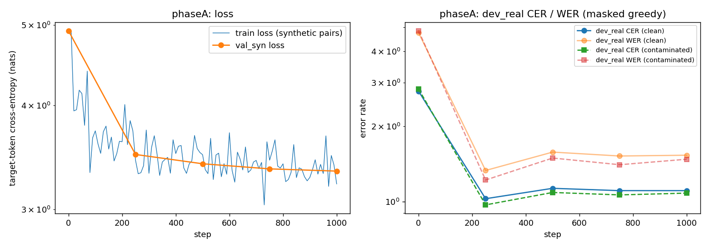
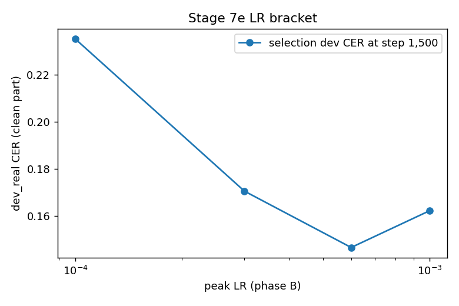
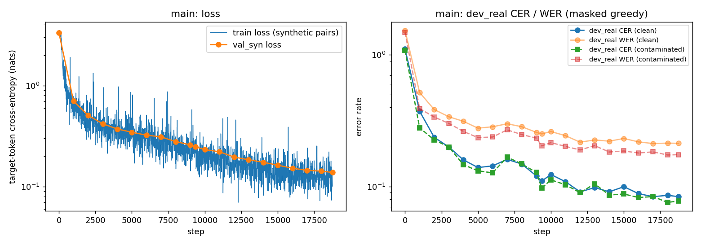

# Stage 7e — Hinglish → Devanagari fine-tune (Kaggle 2×T4)

**Status:** done 2026-11-22. Every step of the spec ran: Phase A, LR bracket, main run, forgetting check, 30 samples, and the A1/A2 ablations.

**Headline:** the main run reaches **dev_real CER 0.084, WER 0.212, EM 0.148** on the clean 500 (best/, step 17,000), down from 1.105 after Phase A.

**What the ablations show:**
- **Phase A does not help.** One-phase A2 matches the main run at epoch 1 (CER 0.108 vs 0.110).
- **Pretraining helps mainly early.** Random init trails by 8.2 CER points at step ~3k but only 1.6 points by epoch 1 (0.126 vs 0.110).

**Forgetting:** the fine-tuned model has lost its plain-Hindi LM ability. LM loss went from 2.79 to 8.75.

**Run details:**
- **Kernel:** `prateek99491/hindi-lm-d7e-train`, one chained pipeline ([finetune/stage7e.py](../../finetune/stage7e.py)).
  - Version 2 ran data → Phase A → bracket → main through step 18,000. It then stopped when the HF private storage cap refused an upload.
  - Version 4 resumed main from `step_018000` and ran everything after it.
  - Both were started with Save Version and the HF_TOKEN secret.
- **Environment:** Python 3.13.16, 2× Tesla T4, DDP. Test suite at kernel start: **187 passed, 1 skipped**.
- **Data:** `hindi-lm-hinglish-pairs@74e39da` under `romanize-v2.1/`. This is v2 plus seven shortcut fixes for the lexicon's weak spots; see [stage7c_RESULTS.md](stage7c_RESULTS.md#romanize-v21-used-for-stage-7e).
- **Settings:** effective batch 64 pairs (micro-batch 32 × 2 GPUs, no accumulation), seed 1337, fp16 autocast + GradScaler, compile off.
- **Train size:** `train` = 600,000 pairs, so **1 epoch = 9,375 steps** and the main run is 18,750 steps.
- **Outputs:**
  - [stage7e.json](stage7e.json): every eval of every run, bracket, forgetting, samples, wall times.
  - Plots: [main](stage7e_main.png), [phase A](stage7e_phaseA.png), [bracket](stage7e_bracket.png).

All dev numbers come from masked greedy decoding with KV cache on the fixed eval subset: 500 clean + 500 contaminated `dev_real` pairs (see 7d). **Selection and the headline use the clean 500.** `test_real` and `test_chat` were not touched.

## Results table

The `clean` columns are the selection metric. `cont.` is the 500 pairs seen in pretraining.

| model | step | val_syn loss | CER clean | WER clean | EM clean | CER cont. | EM cont. |
| --- | --- | --- | --- | --- | --- | --- | --- |
| step 0 (resized base) | 0 | 4.919 | 2.771 | 4.755 | 0.000 | 2.826 | 0.000 |
| Phase A final | 1,000 | 3.336 | 1.105 | 1.533 | 0.000 | 1.080 | 0.000 |
| **main, epoch 1** | 9,375 | 0.247 | **0.110** | 0.251 | 0.114 | 0.097 | 0.172 |
| **main, best/** | 17,000 | 0.145 | **0.084** | 0.212 | 0.148 | 0.084 | 0.226 |
| main, final/ | 18,750 | 0.138 | 0.084 | 0.213 | 0.140 | 0.078 | 0.196 |
| A2: one-phase (no Phase A), epoch 1 | 9,375 | 0.246 | **0.108** | 0.247 | 0.100 | 0.102 | 0.176 |
| A1: random init, LR 6e-4, epoch 1 (better A1) | 9,375 | 0.288 | **0.126** | 0.269 | 0.100 | 0.127 | 0.146 |
| A1: random init, LR 1e-3, epoch 1 | 9,375 | 1.397 | 0.382 | 0.536 | 0.026 | 0.369 | 0.036 |

**About the ablation runs:**
- All ablations use the main run's 2-epoch schedule: same warmup and cosine length, stopped at epoch 1.
- So they are compared at equal steps and equal LR with main's `epoch1/` checkpoint. Main has also had Phase A's 1,000 steps, which touch only the 64 new rows.
- Spec 7e.4 asks for the better of the two A1 runs. That is **LR 6e-4**: the 1e-3 run was unstable, with val_syn loss rising from 1.47 at step 3,125 to 2.03 at step 6,250.

## Phase A (new rows only, LR 1e-3, 1,000 steps)

| step | val_syn loss | dev CER clean | dev WER clean |
| --- | --- | --- | --- |
| 0 | 4.919 | 2.771 | 4.755 |
| 250 | 3.493 | 1.026 | 1.332 |
| 500 | 3.405 | 1.129 | 1.578 |
| 750 | 3.357 | 1.105 | 1.522 |
| 1,000 | 3.336 | 1.105 | 1.533 |

- **What it achieves:** loss falls 32% and the step-0 run-on (CER 2.8) is gone. CER stays above 1 because frozen transformer weights cannot learn the mapping; outputs are fluent Hindi that ignores the input.
- **G5 re-check on `phaseA/final` vs the resized base: pass.** No frozen tensor changed, and 64/64 new rows moved ([stage7e.json](stage7e.json) → `pipeline.g5_after_phaseA`).

## LR bracket (Phase B from `phaseA/final`, 1,500 steps, warmup 100)

| peak LR | dev CER clean | dev WER clean | EM clean | val_syn loss |
| --- | --- | --- | --- | --- |
| 1e-4 | 0.235 | 0.358 | 0.074 | 0.400 |
| 3e-4 | 0.171 | 0.299 | 0.102 | 0.301 |
| **6e-4** | **0.147** | 0.277 | 0.098 | 0.311 |
| 1e-3 (edge point) | 0.162 | 0.297 | 0.094 | 0.328 |

- **Edge point:** 6e-4 was at the edge of the spec's bracket, so 1e-3 was added. 6e-4 is an interior minimum and was picked.
- **CER and loss disagree:** 3e-4 has the lowest val_syn loss but not the lowest CER. That is the case D11 is about.
- **Storage:** bracket weights were deleted from HF after the pick; logs and `done.json` remain.

## Main run (LR 6e-4, 2 epochs, warmup 3% = 562 steps, cosine to 6e-5)

| step | val_syn | CER clean | WER clean | EM clean | CER cont. |
| --- | --- | --- | --- | --- | --- |
| 1,000 | 0.702 | 0.373 | 0.517 | 0.038 | 0.274 |
| 2,000 | 0.507 | 0.236 | 0.384 | 0.070 | 0.225 |
| 3,000 | 0.418 | 0.200 | 0.339 | 0.082 | 0.199 |
| 4,000 | 0.371 | 0.159 | 0.313 | 0.084 | 0.146 |
| 5,000 | 0.345 | 0.139 | 0.277 | 0.104 | 0.131 |
| 6,000 | 0.322 | 0.143 | 0.284 | 0.100 | 0.126 |
| 7,000 | 0.311 | 0.161 | 0.300 | 0.098 | 0.167 |
| 8,000 | 0.278 | 0.148 | 0.285 | 0.096 | 0.150 |
| 9,000 | 0.259 | 0.121 | 0.258 | 0.106 | 0.129 |
| 9,375 (epoch 1) | 0.247 | 0.110 | 0.251 | 0.114 | 0.097 |
| 10,000 | 0.232 | 0.123 | 0.262 | 0.120 | 0.112 |
| 11,000 | 0.221 | 0.109 | 0.243 | 0.116 | 0.103 |
| 12,000 | 0.196 | 0.091 | 0.217 | 0.116 | 0.090 |
| 13,000 | 0.184 | 0.098 | 0.226 | 0.156 | 0.105 |
| 14,000 | 0.174 | 0.091 | 0.221 | 0.138 | 0.087 |
| 15,000 | 0.163 | 0.100 | 0.232 | 0.136 | 0.087 |
| 16,000 | 0.152 | 0.088 | 0.218 | 0.158 | 0.083 |
| **17,000 (best/)** | 0.145 | **0.0837** | 0.212 | 0.148 | 0.084 |
| 18,000 | 0.142 | 0.086 | 0.214 | 0.136 | 0.076 |
| 18,750 (final/) | 0.138 | 0.0837 | 0.213 | 0.140 | 0.078 |

- **Loss:** val_syn falls on every eval, and the last train loss is 0.10. Synthetic-pair loss has not saturated.
- **Dev CER is noisier than loss,** with a bump at 6k–8k (0.139 → 0.161 → 0.148) while loss kept falling. From ~12k it sits at 0.084–0.100. best/ and final/ are tied on clean CER (0.0837).
- **Clean vs contaminated:** the two parts track each other closely (0.084 vs 0.084 at best/). Seeing a sentence's Devanagari in pretraining gives little advantage here.

## Ablations: what pretraining and Phase A contribute

Clean dev CER at matching points. The main run was evaluated every 1,000 steps and the ablations at epoch thirds, so the nearest main eval is shown.

| step (main / ablation) | main (Phase A → B) | A2 (no Phase A) | A1 random init, 6e-4 | A1 random init, 1e-3 |
| --- | --- | --- | --- | --- |
| 3,000 / 3,125 | 0.200 | 0.199 | 0.281 | 0.459 |
| 6,000 / 6,250 | 0.143 | 0.140 | 0.179 | 0.471 |
| 9,375 / 9,375 | **0.110** | **0.108** | **0.126** | 0.382 |

- **A2: Phase A buys nothing measurable.** One-phase fine-tuning from the resized base is equal or slightly better at all three points; the 0.002 gap at epoch 1 is within eval noise. Phase A did cost 31 min of wall time. The 1,000 steps take about 3 min; nearly all the rest is its five dev evals.
- **A1: pretraining helps, but less as training goes on.** The gap to random init closes from 8.2 CER points at ~3k to 3.9 at ~6k and 1.6 at epoch 1, a 13% relative gain at epoch 1. Pretraining mostly speeds up learning on this task. It also makes a near-pretraining LR safe: random init diverges at 1e-3.

## Forgetting check (Hindi LM loss on 200 v2 val windows, 1,024 tokens, plain Devanagari)

| model | loss (full vocab) | loss (base 10,240 IDs only) | BPB | PPL |
| --- | --- | --- | --- | --- |
| base `step_007405` (10,240) | 2.792 | 2.792 | 0.434 | 16.3 |
| resized (10,304, before Phase A) | 2.792 | 2.792 | 0.434 | 16.3 |
| main best/ | **8.755** | 8.744 | 1.361 | 6,341 |
| main final/ | 8.737 | 8.721 | 1.359 | 6,230 |

- **Forgetting is near-total.** 8.75 nats is close to the uniform 9.24 (ln 10,304).
- **It is not probability leaking to the new Latin IDs.** The base-vocab-only loss is the same.
- **The load path is fine.** The same `load_eval_model` produces the good dev samples below.
- **Why it is plausible:**
  - **Steps:** 18,750 full fine-tune steps at a peak LR near pretraining's (6e-4 vs 1e-3) is 2.5× the pretraining step count, with no LM replay.
  - **Data:** every training sequence starts with `<rom>` and is ≤ 256 tokens.
- **Not separated:** we have not measured how much of the 8.75 is lost Hindi modelling and how much is loss of long-context positions (eval windows are 1,024 tokens; training sequences are ≤ 256). The loss on the first 256 positions alone would answer this.
- **Does it matter?** Not for the transliteration demo. It does mean the fine-tuned model is a task model, not a Hindi LM that also transliterates.

## 30 dev_real examples (main best/, 22 failures by strict exact match)

**Selection:** the first 30 of a seeded shuffle of the eval subset, with failures topped up to at least 5. On these 30, pooled CER is 0.035, against 0.084 on the full clean 500. The corpus CER is driven by a minority of badly wrong sentences, which this draw happens to under-sample.

**About a third of the strict failures are orthographic variants, not errors:**
- a trailing `।` added where the reference has none, or `.` vs `।`;
- nukta: मुफ्ती/मुफ़्ती, खुशियों/ख़ुशियों;
- ZWJ inside the reference: वाल्‍मीकि, उज्‍जवल;
- anusvara vs half-nasal: परंपरा/परम्परा, प्रांतर/प्रान्‍तर;
- गये/गए.

Ignoring nukta, ZWJ/ZWNJ, final punctuation and curly quotes moves these 30 from 8 to 12 exact and pooled CER from 0.035 to 0.030. Real errors are rare names (कनेटक for कानेटकर, नाटीओना for "Nationa"), number agreement (है/हैं), and heavily misspelled input (*Vidnyan* → विदन).

| # | cont. | romanized input | reference | model output | ok |
| --- | --- | --- | --- | --- | --- |
| 187 | clean | Tol Tamil bhsha ke vikhyat sahityakar D. | तोल तमिल भाषा के विख्यात साहित्यकार डी. | तोल तमिल भाषा के विख्यात साहित्यकार डी। | ✗ punct |
| 320 | clean | yahan ham aapko batate chalen ki Magadh ke sabse Prachin Vansh ke Sansthapak ka naam bhi | यहां हम आपको बताते चलें कि मगध के सबसे प्राचीन वंश के संस्थापक का नाम भी | …का नाम भी। | ✗ punct |
| 388 | exact | ya ho sakta hai. | या हो सकता है। | या हो सकता है। | ✓ |
| 449 | clean | Raj Mehra | राज मेहरा | राज मेहरा । | ✗ punct |
| 672 | exact | Kaii American Expres credit card ke vigyapanon men 'C F Frost" naam likha hua ek namuna American Express card dikhya gaya hai. | कई अमेरिकन एक्सप्रेस क्रेडिट कार्ड के विज्ञापनों में ’सी एफ़ फ़्रोस्ट" नाम लिखा हुआ एक नमूना अमेरिकन एक्सप्रेस कार्ड दिखाया गया है। | कई एमेरिकन एक्सप्रेस क्रेडिट कार्ड के विज्ञापनों में 'सीएफ फ्रॉस्ट" नाम लिखा हुआ एक नमूना अमेरिकान एक्सप्रेस कार्ड दिखया गया है। | ✗ |
| 762 | clean | ansu ban gaye phul - vasanta kanetakar | आंसू बन गये फूल - वसंत कानेटकर | आंसू बन गए फूल - वसंता कनेटक | ✗ name |
| 944 | clean | mein samapt ho gaya. | में समाप्त हो गया। | में समाप्त हो गया। | ✓ |
| 958 | exact | yeh thailand ka sabse bada, sabse adhik aabadi vala dvip hai. | यह थाइलैंड का सबसे बड़ा, सबसे अधिक आबादी वाला द्वीप है। | यह थाईलैंड का सबसे बड़ा, सबसे अधिक आबादी वाला द्वीप है। | ✗ variant |
| 983 | clean | mula saag ek odiya vyanjan hai. | मूला साग एक उड़िया व्यंजन है। | मूला साग एक ओड़िया व्यंजन है। | ✗ |
| 1002 | exact | makka ke mufti ali bin hasan maliki ne khan ko sabhi dharmik vigyano ka vishvkosh kaha. | मक्का के मुफ्ती अली बिन हसन मलिकी ने खान को सभी धार्मिक विज्ञानों का विश्वकोष कहा। | मक्का के मुफ़्ती अली बिन हसन मालिकी ने खान को सभी धार्मिक विज्ञानो का विश्वकोश कहा. | ✗ |
| 1462 | exact | unke nana-nani holocaust uttarjivi the. | उनके नाना-नानी होलोकौस्ट उत्तरजीवी थे। | उनके नाना-नानी होलोकौस्ट उत्तरजीवी थे। | ✓ |
| 1744 | exact | sahitya men ek prachin viswaas, kavisamay ya kaviprasiddh ke roop men iska ullekh milta hai jahan vruksh ke sath prayukt hokar yah shabdh 'Pushpodgam' arth deta hai. | …कविसमय या कविप्रसिद्धि के रूप में… 'पुष्पोद्गम' अर्थ देता है। | …कविसमय या कविप्रसिद्ध के रूप में… 'पुष्पोद्गम' अर्थ देता है। | ✗ (input lacks *-i*) |
| 1789 | clean | Radhamma ke ghar men hua tha. | राधाम्मा के घर में हुआ था। | राधाम्मा के घर में हुआ था। | ✓ |
| 2023 | clean | teesri sahastrabdi se … Sumeri, Babuli tatha akkadi sabhyata ke antargat kramash: viksit dharm ki pradhan baat thi. | तीसरी सहस्त्राब्दी से … सुमेरी, बाबुली तथा अक्कादी सभ्यता … | तीसरी सहस्राब्दी से … सुमेरी, बबुली तथा अक्कड़ी सभ्यता … | ✗ names |
| 2340 | exact | sathi janvar naidanik model ke rup me kargar hai kyonki ve manav rogo ki nikat'ta aur unki nakal me prasangik hai. | …कारगर हैं क्योंकि वे मानव रोगों की निकटता… | …कारगर है क्योंकि वे मानव रोगो की निकट'ता… | ✗ |
| 2348 | exact | bhartiya samaj mein Valmiki ya bhangee ko … paramparik pesha manav mal ki safai karna raha hai. | …वाल्‍मीकि … पारंपरिक पेशा मानव मल… | …वाल्मीकि … पारम्परिक पेशा मानव माल… | ✗ (ZWJ, *mal*) |
| 2396 | exact | Yah yuvavastha ka sahi samay hota hai. | यह युवावस्था का सही समय होता है। | यह युवावस्था का सही समय होता है। | ✓ |
| 2536 | exact | iske paschim me albama aur dakshin me florida rajya sthita hai. | …अलबामा … राज्य स्थित हैं। | …अल्बामा … राज्य स्थिता है। | ✗ |
| 3128 | exact | mein hogaa. | में होगा। | में होगा। | ✓ |
| 3251 | exact | Devnarayan Fad parmpara | देवनारायण फड़ परम्परा | देवनारायण फाड़ परम्परा | ✗ |
| 3484 | exact | Nai kavita men keval Sanskrut shabdon ko hi adhar nahi banaya hai, balki … swikar kiya gaya hai. | नई कविता में केवल संस्कृत शब्दों को ही आधार नहीं बनाया है, … | identical | ✓ |
| 3531 | exact | imarat Saint Mary Nationa School … punarviksit ki gayi thi aur ab isme ek samudaayik kendra hai. | इमारत सेंट मेरी नेशनल स्कूल … पुनर्विकसित … इसमें … केंद्र है। | इमारत सेंट मैरी नाटीओना स्कूल … पुनर्विक्षित … इसमे … केंद्र हैं। | ✗ |
| 3853 | exact | san 2000 men … Hindi aur Angreji … Arbi, French, tatha Potugij bhi padhai jati hain. | सन् 2000 में … हिन्दी … पोर्चुगीज … | सन 2000 में … हिंदी … पोटुगीज … | ✗ |
| 4052 | exact | sanyukt pariwaar men sanbdhiyon ka dayra … | …संबंधियों का दायरा… | …सनब्धियों का दायरा… | ✗ (misspelt input) |
| 4058 | clean | Europe aur america ke kai vishvavidyalayo me unke vyakhyan ho chuke hai. | यूरोप और अमेरिका के कई विश्वविद्यालयों में उनके व्याख्यान हो चुके हैं। | identical | ✓ |
| 4238 | clean | Aathave dashak ke log - Balram Manish Rai | आठवें दशक के लोग - बलराम मनीष राय | आठवे दशक के लोग - बलराम मनीष राय | ✗ |
| 4441 | clean | sambhvat: yah Sanskrut 'Dauhrad' shabd ka prakritik roop hai … | …'दौहृद' शब्द का प्राकृत रूप… | …'दौहराद' शब्द का प्राकृतिक रूप… | ✗ (input says *prakritik*) |
| 4482 | exact | Vidnyan avn prodyogiki vibhak ke avlamb se … | विज्ञान एवं प्रौद्योगिकी विभाग के अवलंब से … | विदन एवं प्रोद्योगिकी विभक के अवलम्ब से … | ✗ |
| 4567 | exact | nawvarsh, ateet par drushti dalne … utsah v khushiyon se … | …उत्साह व ख़ुशियों से… | …उत्साह व खुशियों से… | ✗ nukta |
| 4959 | clean | yuva katha lekhan ke vikassheel prantar me ujjaval upalabdhi … | …प्रान्‍तर में उज्‍जवल उपलब्धि … उपन्‍यास है। | …प्रांतर में उज्ज्वल उपलब्धि … उपन्यास है। | ✗ (ZWJ, variants) |

Long rows are shortened with "…" where input and output agree. The full strings are in [stage7e.json](stage7e.json) → `samples_dev_real`.

## Wall time per step (2×T4 unless noted)

| step | wall (min) | GPU-min |
| --- | --- | --- |
| 7c data build (CPU work inside the kernel) | 22 | — |
| forgetting, base + resized | 0.5 | 1 |
| Phase A (1,000 steps + 5 evals) | 31 | 62 |
| G5 re-check | 0.2 | — |
| bracket, 4 × 1,500 steps | 33 | 67 |
| main (18,750 steps + 21 evals, across 2 sessions) | 140 | 281 |
| forgetting after main, samples, report | 1.3 | 3 |
| A2 one-phase (9,375 steps) | 41 | 82 |
| A1 random init 6e-4 | 42 | 83 |
| A1 random init 1e-3 | 41 | 82 |
| **total** | **353 (5.9 h)** | **~660 (11 GPU-h)** |

Training runs at about 5.1 steps/s (2×T4, micro-batch 32, 4.4 GB peak memory per GPU). A 500 + 500 dev eval takes about 200 s.

## Weights on HF (`Prateek-Tiwari10/hindi-lm-checkpoints`, weights only, 245 MB each)

| run | folders |
| --- | --- |
| `d7/phaseA/` | `best/`, `final/` |
| `d7/main/` | `best/` (step 17,000, **the model to use**), `epoch1/`, `final/` |
| `d7/A2_onephase/` | `best/`, `epoch1/`, `final/` |
| `d7/A1_scratch_6e-4/`, `d7/A1_scratch_1e-3/` | `best/`, `epoch1/`, `final/` |
| `d7/bracket_*/` | logs and `done.json` only (weights deleted after the pick) |

Each run's resume checkpoint (with optimizer state) was deleted once the run finished. After each run the pipeline squashes the checkpoint repo's history and deletes orphaned LFS objects. Without this, the storage counter keeps every pruned checkpoint; that is what stopped version 2.

## Departures from the spec

1. **One chained kernel** (`hindi-lm-d7e-train`) instead of separate phaseA / bracket / main / ablations kernels. Every HF run needs a manual Save Version, so chaining keeps that to one click per session. Each step is skipped when its result is already on HF.
2. **Model selection uses clean dev CER** (the 7d contamination rule), not CER on the whole subset.
3. **Ablations stop at epoch 1 of the 2-epoch schedule** (`--stop-after-epochs 1`). This keeps them equal to main's `epoch1/` checkpoint in LR at every step, so init is the only difference.
4. **Data is `romanize-v2.1`,** not v2. Seven shortcut fixes were made after Prateek's review of the v2 weak spots; see [stage7c_RESULTS.md](stage7c_RESULTS.md#romanize-v21-used-for-stage-7e).
5. **Train loss is plotted, not tabled.** It is in `logs/main.jsonl` on HF.
6. **The forgetting check is also run on `final/`,** not only `best/`.
